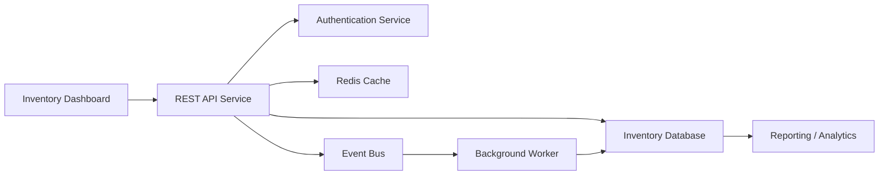
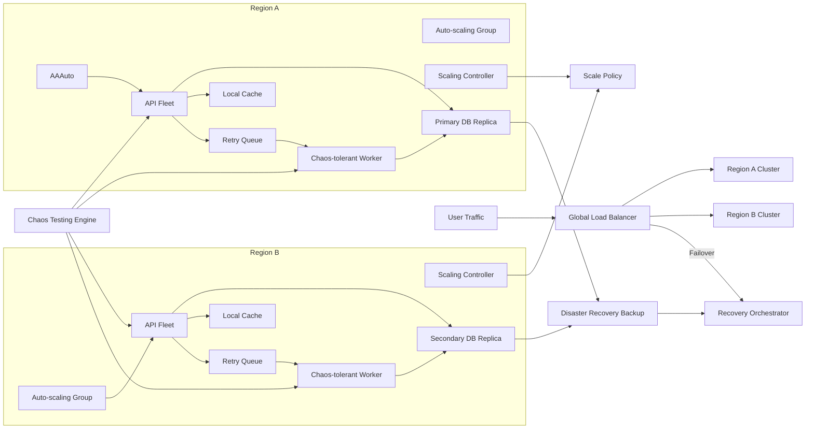

# 📦 Inventory System – Enterprise‑Grade CI/CD & Resilience

This repository contains a **production‑ready inventory management system** with a complete DevOps pipeline and resilience workflows. It’s designed to be globally available, self‑healing, compliant, and cost‑optimized.

---

## 🚀 Features

- **CI/CD Pipeline** – Automated build, test, and deploy with GitHub Actions
- **Backups & Restores** – Deploy‑time backups, nightly scheduled backups, and manual restore workflows
- **Monitoring & Alerts** – Daily health checks, Slack notifications, observability validation (logging, metrics, tracing)
- **Resilience & Scaling** – Auto‑scaling, disaster recovery failover, multi‑region deployment, chaos engineering experiments
- **Governance & Compliance** – Security scans, GDPR/ISO compliance checks, coding standards enforcement, documentation validation
- **Quality Gates** – Unit tests, coverage thresholds, performance benchmarking
- **Cost Optimization** – Off‑peak scaling to reduce expenses while maintaining redundancy

---

## Architecture



## Resilience Flow



---

## 📂 Repository Structure

```
your-repo/
  .github/
    workflows/
      deploy.yml
      backup.yml
      restore.yml
      health-check.yml
      auto-scale.yml
      disaster-recovery.yml
      multi-region.yml
      cost-optimization.yml
      compliance.yml
      governance.yml
      quality-gate.yml
      performance.yml
      observability.yml
      chaos.yml
```

---

## 🔐 Required Secrets

Configure these in **Settings → Secrets and variables → Actions**:

- `MONGO_URI` → MongoDB connection string
- `AZURE_REGISTRY_LOGIN_SERVER`, `AZURE_REGISTRY_USERNAME`, `AZURE_REGISTRY_PASSWORD`
- `AZURE_WEBAPP_NAME`, `AZURE_RESOURCE_GROUP`, `AZURE_APP_PLAN`
- `AZURE_STORAGE_CONNECTION_STRING`
- `AZURE_SUBSCRIPTION_ID`
- `AZURE_RESOURCE_GROUP_EAST`, `AZURE_APP_PLAN_EAST`, `AZURE_WEBAPP_NAME_EAST`
- `AZURE_RESOURCE_GROUP_WEST`, `AZURE_APP_PLAN_WEST`, `AZURE_WEBAPP_NAME_WEST`
- `AZURE_TRAFFIC_RG`
- `SLACK_WEBHOOK_URL`
- `JWT_SECRET`

---

## 🛠️ Workflows Overview

- **`deploy.yml`** → CI/CD pipeline for build & deploy
- **`backup.yml`** → Nightly database backups
- **`restore.yml`** → Manual restore from backups
- **`health-check.yml`** → Daily health monitoring
- **`auto-scale.yml`** → Auto‑scaling based on CPU/memory
- **`disaster-recovery.yml`** → Failover to standby environment
- **`multi-region.yml`** → Active‑active deployment across regions
- **`cost-optimization.yml`** → Scale down non‑critical regions off‑peak
- **`compliance.yml`** → Security scans & GDPR/ISO checks
- **`governance.yml`** → Enforce coding standards & documentation
- **`quality-gate.yml`** → Unit tests & coverage enforcement
- **`performance.yml`** → Load testing & SLA validation
- **`observability.yml`** → Logging, metrics, tracing validation
- **`chaos.yml`** → Chaos engineering experiments

---

## 🌍 Architecture

- **Azure Web Apps** for hosting
- **Azure Container Registry** for images
- **Azure Traffic Manager** for multi‑region routing
- **MongoDB** for database storage
- **Slack** for notifications

---

## ✅ First Run Guide

1. Add workflows to `.github/workflows/`
2. Configure secrets in GitHub Actions
3. Trigger **Deploy Inventory System** manually
4. Verify backups, restores, monitoring, scaling, and chaos experiments
5. Configure Traffic Manager DNS for global routing

---

## ✨ Why It Matters

This repo demonstrates how to build a **world‑class inventory system** that is:
- Self‑healing
- Globally resilient
- Secure and compliant
- Performance‑validated
- Cost‑efficient

---

## 📜 License

MIT License – free to use and adapt.
