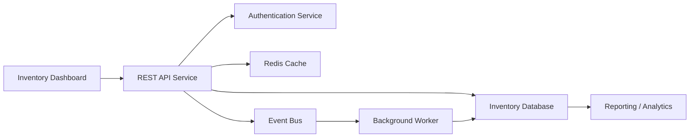

# Inventory-Pro
Inventory System – Enterprise‑Grade CI/CD &amp; Resilience  This repository contains a production‑ready inventory management system with a complete DevOps pipeline and resilience workflows. It’s designed to be globally available, self‑healing, compliant, and cost‑optimized.

## Architecture

