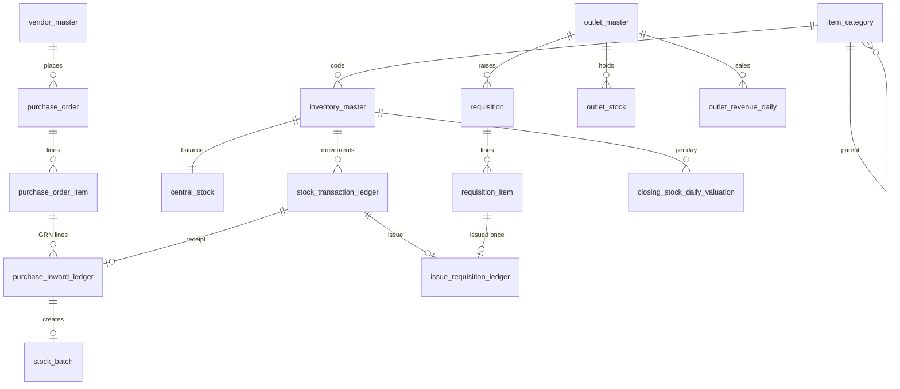

# Hotel Central Store – Architecture Blueprint

Implementation blueprint for the centralized warehouse (central store) of a multi-outlet hotel:
purchasing, outlet requisitions, the stock-deduction engine, forecasting and reorder mechanics,
valuation and cost control, and the audit trail. Everything described here is implemented in
this repository; file references point at the code that does it.

| Layer | Where |
|---|---|
| Database schema (Prisma) | `server/prisma/schema.prisma` |
| Database schema (plain SQL, reference) | `server/prisma/schema.sql` |
| Migrations (what actually builds the database) | `server/prisma/migrations/` |
| HTTP API | `server/src/routes/index.js`, `server/src/routes/auth.js` |
| Business services | `server/src/services/*.js` |
| Pure maths (unit-tested) | `server/src/lib/planning.js`, `forecast.js`, `scorecard.js` |
| Web app | `frontend/src/pages/*.js` |
| Tests | `server/test/*.test.js` |

---

## 1. Architecture overview

```
 React web app (frontend/)          ── HTTPS / JSON ──►  Express API (/api, JWT, roles)
                                                           │  auditTrail middleware → audit_log
                                                           ▼
                    services/ ─ purchasing · requisitions · inventory · vendors · market
                              ─ replenishment (forecast → levels → order qty)
                              ─ valuation (daily snapshots) · controlling (COGS, DOH, ABC-XYZ)
                              ─ audit (ledger verification, read-only ledgers)
                                                           │
                    services/ledger.js  ◄── the only code that changes central stock
                       lockCentral → consumeBatches → writeCentral → appendEntry (hash chain)
                                                           │
                    PostgreSQL 16 ─ row locks, CHECK constraints, append-only triggers
```

Rules that hold everywhere:

1. **One write path for stock.** Every change to central stock (receipt, issue, waste,
   adjustment) goes through `services/ledger.js` inside a database transaction.
2. **Lock first, read second.** The item's `central_stock` row is locked
   (`SELECT … FOR UPDATE`) before its quantity is read.
3. **Ledgers are append-only.** The database refuses UPDATE, DELETE and TRUNCATE on
   `stock_transaction_ledger`, `purchase_inward_ledger`, `issue_requisition_ledger` and `audit_log`.
4. **Money is exact.** Quantities are `DECIMAL(12,3)`, unit costs `DECIMAL(12,2)`, values
   `DECIMAL(14,2)`; arithmetic on values uses `Prisma.Decimal`.

---

## 2. Core modules

### 2.1 Vendor purchase entry

**Multi-tier categories** (`item_category`): level 1 group → level 2 category → optional
level 3 sub-category. Items attach to level 2 or 3 by the category's stable `code`.

```
Food                     Beverages                       Non-food & operating supplies
├─ Groceries (180 d)     ├─ Bar & liquor                 ├─ Linen
│  └─ Dry goods (365 d)  └─ Soft beverages (270 d)       ├─ Guest amenities
├─ Fruits & veg (5 d)*                                   ├─ Cleaning & chemicals
├─ Dairy (7 d)*                                          ├─ Front office & stationery
├─ Meat & poultry (3 d)*                                 └─ Engineering spares
│  └─ Chicken · Mutton · Beef · Pork · Birds & game
└─ Seafood (2 d)*                    * perishable; (n d) = default shelf life
```

Categories carry `is_perishable` and `default_shelf_life_days`; an item may override the
shelf life (`inventory_master.shelf_life_days`). Filtering by a category includes everything
below it. API: `GET/POST /categories`, `PATCH /categories/:code`.

**Purchase order lifecycle** (`services/purchasing.js`):

```
DRAFT ──send──► SENT ──receive──► PARTIALLY_RECEIVED ──receive──► RECEIVED
  │               │                      │
  └──cancel──►  CANCELLED ◄──cancel──┘   └──close short──► RECEIVED (balance no longer on order)
```

Direct purchase entry (cash / market purchase, invoice without PO) creates, sends and receives
in one transaction (`POST /purchase-orders/direct`).

**Goods receipt (GRN)** – `POST /purchase-orders/:id/receive`

```json
{ "invoiceNumber": "FARM-881", "invoiceDate": "2026-10-22", "receivedAt": "…optional…",
  "lines": [{ "poItemId": "…", "quantityReceived": 10, "quantityRejected": 2, "rejectionReason": "Smell",
              "unitPrice": 205.5, "batchNumber": "LOT-4471", "expiryDate": "2026-10-25", "manufactureDate": "…" }] }
```

Algorithm (`receiveInTx`):

1. Lock the PO row; refuse unless status is SENT or PARTIALLY_RECEIVED.
2. One GRN number per request (`GRN-YYYYMMDD-XXXXXX`).
3. Process lines in item-id order (deadlock avoidance). Per line:
   - received + rejected ≤ outstanding; rejections need a reason;
   - expiry defaults to (manufacture date or receipt date) + shelf life; goods already past
     expiry cannot be accepted;
   - accepted quantity → `ledger.receiveIntoCentral`: re-averages the cost, writes the
     hash-chained ledger row, the `purchase_inward_ledger` row (batch, expiry, invoice, unit of
     measure, receiver) and a `stock_batch`;
   - a fully rejected line still gets an inward row (no stock movement).
4. PO status becomes RECEIVED when every line is fully received or rejected.

Unit metrics: every item has a `unit_of_measure` (kg, ltr, pcs, pack…), an `order_multiple`
(pack size, fractional allowed) and three-decimal quantities.

### 2.2 Multi-outlet requisitions

Outlets (`outlet_master`) are the hotel's kitchens, bars and departments: `code`, `name`,
`main_outlet` + `sub_department`, `outlet_type` (KITCHEN, RESTAURANT, BAR, HOUSEKEEPING,
FRONT_OFFICE, ENGINEERING, OTHER), `cost_center`, `is_active`.

```
PENDING ──approve──► APPROVED ──issue──► ISSUED
   └──reject──► REJECTED
```

| Role | Can |
|---|---|
| `user` (staff) | raise requisitions, follow them, Indent vs Received report – nothing else (server allow-list) |
| `approver` | approve/reject/issue, purchasing, stock, master data, all reports, ledger verification |
| `admin` | everything, plus users and the API audit log |

Issuing may be partial per line (`lines: [{ requisitionItemId, quantityIssued }]`); omitted lines
are issued in full.

### 2.3 Auto-update and stock-deduction engine

`issueInTx` (`services/requisitions.js`) and `issueFromCentral` (`services/ledger.js`):

```
BEGIN
  SELECT … FROM requisition WHERE id = $1 FOR UPDATE        -- 1. serialise requests for this requisition
  if replay of the same Idempotency-Key → return the original result
  require status = APPROVED                                  -- 2. state machine: issued at most once
  for each line ORDER BY item_id:                            -- 3. fixed lock order: no deadlocks
     SELECT quantity_on_hand FROM central_stock WHERE item_id = $i FOR UPDATE
     require quantity ≤ on hand                              -- else 409 and the whole issue rolls back
     consume stock_batch rows: earliest expiry, then oldest receipt (FEFO)
     central_stock.quantity_on_hand −= quantity; total_value = qty × WAC
     append stock_transaction_ledger row (hash-chained)
     insert issue_requisition_ledger row (UNIQUE requisition_item_id, batch allocations)
     outlet_stock += quantity; requisition_item.quantity_issued/unit_cost/issued_value
  requisition.status = ISSUED, issue_idempotency_key = key
COMMIT
```

**Cryptographically unique ledger rows.** Each `stock_transaction_ledger` row gets an
application-generated UUID and

```
entry_hash = SHA-256( prev_hash ␟ id ␟ item_id ␟ type ␟ source ␟ destination ␟ quantity(3dp)
                      ␟ unit_cost(2dp) ␟ value(2dp) ␟ closing_qty(3dp) ␟ closing_value(2dp)
                      ␟ reference_id ␟ remarks ␟ created_by ␟ timestamp(ISO-8601 ms) )
prev_hash  = entry_hash of the item's previous row, or 'GENESIS'          (␟ = U+001F)
```

`entry_hash` is UNIQUE and `(item_id, prev_hash)` is UNIQUE, so the per-item chain can never
fork even if two writers raced. Chains are per item, so different items are written in parallel;
the item row lock serialises writers of the same chain.

---

## 3. Advanced data models and forecasting

### 3.1 ABC analysis (value)

Annualised consumption value per item = (issues + central waste value over the planning window)
× 365 ÷ window. Sort descending; cumulative share before the item < 80% → **A**, < 95% → **B**,
otherwise **C** (`lib/planning.js#classifyAbc`).

### 3.2 XYZ analysis (demand volatility)

Coefficient of variation of weekly demand, CV = σ(weekly) ÷ mean(weekly): **X** ≤ 0.5,
**Y** ≤ 1.0, **Z** above or no demand (`classifyXyz`).

### 3.3 ABC-XYZ matrix and policy

`GET /reports/abc-xyz` returns the 9 cells with item count, consumption-value share, stock value,
top items and the control policy:

| | X steady | Y variable | Z erratic |
|---|---|---|---|
| **A** | small frequent lots vs forecast, low SS, weekly review | forecast + SS buffer, twice-weekly review, rate contracts | buy against confirmed requisitions/menus, daily review, never stockpile |
| **B** | automatic reorder at ROP, fortnightly | automatic with seasonal min/max checks | order on demand with a small buffer |
| **C** | bulk at pack size, monthly | bulk with generous buffer, monthly | order on request; delist/substitute |

### 3.4 Demand forecasting (`lib/forecast.js`)

Input: daily central-store demand (issues + central waste) for up to `FORECAST_HISTORY_DAYS`
(364), starting at the item's first recorded demand. Weekly totals feed three models:

| Model | Formula |
|---|---|
| SMA | mean of all weeks (baseline) |
| WMA | Σ wᵢ·yᵢ ÷ Σ wᵢ over the last 4 weeks, weights 1-2-3-4 (newest heaviest) |
| HOLT (damped) | Lₜ = α·yₜ + (1−α)(Lₜ₋₁ + φTₜ₋₁); Tₜ = β(Lₜ − Lₜ₋₁) + (1−β)φTₜ₋₁; ŷₜ₊ₕ = Lₜ + (φ+…+φʰ)Tₜ |

α = 0.3, β = 0.1, φ = 0.9 by default (`FORECAST_ALPHA/BETA/PHI`). Each model is back-tested
one step ahead on the last 4 weeks; the lowest total absolute error wins, and its accuracy is
reported as 1 − WMAPE. With fewer than 8 weeks of history SMA is used.

**Seasonality.** With ≥ 365 days of history, a month-of-year index
`index(m) = avg daily demand in month m ÷ avg daily demand over the year` (clamped 0.5–2.0) is
averaged over the forecast horizon and multiplies the forecast.

**Market trend.** If an item is not perishable and its average purchase/market price over the
last 30 days is ≥ `PRICE_RISE_THRESHOLD` (5%) above the 30 days before, the maximum level gets
`FORWARD_BUY_DAYS` (7) of extra cover, within shelf life.

Horizon = lead time L + review period R. Output per item: `forecastDailyDemand`, `forecastMethod`,
`forecastAccuracyPct`, `seasonalIndex`, `trendPerWeek`, `priceTrendPct` (`GET /reports/forecast`).

### 3.5 Reorder mechanics (`services/replenishment.js`, `lib/planning.js`)

```
d   = forecast daily demand            σd = std-dev of daily demand (last 90 days)
L   = vendor's actual average lead time (promised lead time until deliveries exist), σL its std-dev
Z   = service-level factor (SERVICE_LEVEL_Z, 1.65 ≈ 95%)      R = review period (7 days)

Safety stock (= minimum)  SS  = ⌈ Z · √(L·σd² + d²·σL²) ⌉
Reorder point             ROP = ⌈ d·L + SS ⌉
Maximum                   MAX = max(ROP, ⌈ SS + d·(L + R) ⌉)  (+ forward-buy cover)
Shelf-life cap            MAX = max(ROP, ⌈ d · shelf-life days ⌉) when that is lower
Order when                on hand + on order ≤ ROP
Order quantity            Q = MAX − (on hand + on order), in whole packs
```

**Over-purchase guards:** quantities on open POs count as stock; partially delivered POs can be
closed short so the balance stops counting; pack rounding goes up by default but **down** when
rounding up would exceed MAX by more than half a pack (and rounding down still clears ROP); the
shelf-life cap stops perishables being bought beyond what can be used before they expire.
`POST /replenishment/recalculate` writes the levels and ABC/XYZ onto `inventory_master`
(items with `auto_planning = false` keep manual levels); `POST /replenishment/purchase-orders`
turns suggestions into one draft PO per vendor at the vendor's latest price.

---

## 4. Financial core

### 4.1 Stock valuation

**Book value: weighted average cost (WAC).** On every receipt:
`WAC' = (qty_on_hand × WAC + qty_received × price) ÷ (qty_on_hand + qty_received)`.
Issues, waste and adjustments leave at the current WAC. `central_stock.total_value` and every
ledger row carry the running closing value.

**Comparison: FIFO.** The same closing quantity priced at the most recent receipts (newest
first until the quantity is covered; any uncovered remainder at WAC). The difference to WAC is
the revaluation effect of price movements. The live layer value is also available from
`stock_batch` (remaining quantity × each batch's cost).

**Daily snapshot** (`closing_stock_daily_valuation`, `services/valuation.js`): per item and
business day (UTC) – opening, received, issued, waste, adjustment (qty and value), closing qty,
WAC unit cost, closing value WAC and FIFO, trailing 30-day average daily issue value and days on
hand. Rows are derived from the ledger and regenerated idempotently. A scheduler fills missing
completed days every `VALUATION_SNAPSHOT_INTERVAL_MINUTES` (60); `POST /valuation/snapshots
{from,to}` rebuilds a range (≤ 400 days).

### 4.2 Cost of goods

Period statement (Reports page): **COGS = opening stock + purchases − closing stock**,
reconciled against issues + central waste − adjustments; any remainder is shown as revaluation.

Per outlet (`GET /reports/outlet-cogs?from&to`, "direct issue" method):

```
COGS(outlet)   = Σ value issued to the outlet
Share %        = COGS(outlet) ÷ Σ COGS × 100
Cost % of sales = COGS(outlet) ÷ outlet revenue × 100     (outlet_revenue_daily)
```

split by item group (food cost, beverage cost, non-food) and by outlet type; waste written off
inside an outlet is shown as a memo (it is already part of what was issued). Sales per outlet per
day: `PUT /departments/:id/revenue {businessDate, revenue}`.

### 4.3 Days on hand, turnover, ageing (`GET /reports/inventory-health`)

```
avg daily consumption value = (issues + central waste) value, last 30 days ÷ 30
Days on hand (DOH)          = stock value ÷ avg daily consumption value
Annual turnover             = consumption value, last 90 days × 365/90 ÷ average stock value
                              (average of daily snapshots; current value if < 7 snapshots)
Average age (days)          = Σ(batch remaining × days since received) ÷ Σ remaining
At-risk quantity            = stock in batches expiring within 7 days that current usage
                              (shared earliest-expiry first) will not consume before expiry
```

Status per item: **EXPIRED** (batches past expiry) → **NON_MOVING** (stock but no issue for
`SLOW_MOVING_DAYS`, 60) → **SLOW** (DOH > 60) → **AT_RISK** → **HEALTHY**. The summary gives the
capital tied up in each.

---

## 5. Database architecture

Full DDL: [`server/prisma/schema.sql`](../server/prisma/schema.sql) (identical to what the
migrations build). Core tables:



| Table | Key columns | Keys and constraints | Indexes |
|---|---|---|---|
| `inventory_master` | sku, barcode, item_name, category, unit_of_measure, cost_price (WAC), min_stock_level, max_stock_level, reorder_point, order_multiple, shelf_life_days, abc/xyz_category, auto_planning, preferred_vendor_id | PK id; UNIQUE sku, barcode; FK category → item_category.code, preferred_vendor_id → vendor_master; CHECK levels ≥ 0, order_multiple > 0, shelf life > 0 | category |
| `vendor_master` | vendor_name, contact, email, phone, address, tax_id, payment_terms_days, lead_time_days, rating_matrix (JSONB), overall_rating, rated_at | PK id | – |
| `purchase_inward_ledger` | grn_number, purchase_order_id, purchase_order_item_id, item_id, vendor_id, batch_number, manufacture/expiry_date, quantity_received/rejected, rejection_reason, unit_of_measure, unit_price, line_value, invoice_number/date, received_by, received_at, transaction_id | PK id; FKs to PO, PO line, item, vendor, ledger row; UNIQUE transaction_id; CHECK quantities, received > 0 ⇔ ledger row, expiry ≥ manufacture; **append-only** | (item_id, received_at), (vendor_id, received_at), purchase_order_id, grn_number, invoice_number, expiry_date |
| `outlet_master` | code, name, main_outlet, sub_department, outlet_type, cost_center, is_active | PK id; UNIQUE code, (main_outlet, sub_department) | – |
| `issue_requisition_ledger` | issue_number, requisition_id, requisition_item_id, item_id, outlet_department_id, quantity_requested/issued, unit_cost, issue_value, batch_allocations (JSONB), issued_by, issued_at, transaction_id | PK id; **UNIQUE requisition_item_id** (a line is issued once); UNIQUE transaction_id; CHECK 0 < issued ≤ requested; **append-only** | (outlet, issued_at), (item, issued_at), requisition_id |
| `closing_stock_daily_valuation` | business_date, item_id, opening/received/issued/waste/adjustment qty+value, closing_qty, wac_unit_cost, closing_value_wac, closing_value_fifo, avg_daily_issue_value, days_on_hand | PK (business_date, item_id); FK item; CHECK closing_qty ≥ 0 | (item_id, business_date) |
| `stock_transaction_ledger` | seq, item_id, type, source/destination, quantity, unit_cost, transaction_value, closing qty/value, reference_id, remarks, created_by, timestamp, recorded_at, prev_hash, entry_hash | PK id; UNIQUE seq, entry_hash, (item_id, prev_hash); **append-only** | (item_id, timestamp), (type, timestamp), timestamp |
| `stock_batch` | item_id, inward_id, source, batch_number, expiry_date, received_at, unit_cost, quantity_received/remaining | PK id; UNIQUE inward_id; CHECK 0 ≤ remaining ≤ received | (item_id, expiry_date, received_at) |
| `central_stock` / `outlet_stock` | quantity_on_hand, total_value | CHECK quantity_on_hand ≥ 0 | item / (outlet, item) unique |

---

## 6. Security, transfers and audit trail

### 6.1 No double deductions, no race conditions

| Threat | Defence |
|---|---|
| Two people press "Issue" on the same requisition | requisition row lock + APPROVED → ISSUED state check: the second request waits, then gets 409 |
| Client retries after a timeout | `Idempotency-Key` header (or `idempotencyKey`): the retry returns the original result (`replayed: true`) |
| A bug or race issues a line twice | `issue_requisition_ledger.requisition_item_id` UNIQUE – the database refuses |
| Two outlets draw the same item at once | `central_stock` row lock; the second sees the first's deduction |
| Stock driven negative | quantity check under the lock, plus CHECK `quantity_on_hand >= 0` on central and outlet stock and on batches |
| Deadlock between concurrent issues/receipts | locks always taken in item-id order; deadlock or serialisation failures are retried up to 3 times (`inTransaction`) |
| Concurrent receipts exceed the order | PO row lock before the outstanding-quantity check |
| Ledger chain fork | UNIQUE (item_id, prev_hash) |
| Partial failure | each issue/receipt is one transaction: any failing line rolls back every line |

### 6.2 Read-only historical log

- `stock_transaction_ledger`, `purchase_inward_ledger`, `issue_requisition_ledger` and `audit_log`
  have `BEFORE UPDATE OR DELETE` row triggers and `BEFORE TRUNCATE` statement triggers that raise
  `insufficient_privilege`. Corrections are new entries (adjustments), never edits.
- The only escape is `SET LOCAL inventory.allow_ledger_purge = 'on'`, which permits DELETE (never
  UPDATE); the demo seed uses it to reset. **Production:** run the app as a role without
  table ownership and `REVOKE DELETE, TRUNCATE` on the ledgers from it, so the flag is useless.
- `GET /ledger/verify` recomputes every hash and checks each item's last closing balance against
  `central_stock` and the batch total. It returns the chain heads (last `entry_hash` per item);
  export them regularly (e.g. with the backup workflow): a later verification against an exported
  head proves history was not rewritten, even by someone able to recompute hashes.
- `audit_log`: every POST/PUT/PATCH/DELETE under `/api` – actor id/name/role, method, path,
  status code (refused requests too), entity id and the request body with passwords, tokens and
  secrets redacted. Admin only: `GET /audit/log`.
- Read APIs: `GET /ledger/transactions`, `/ledger/inward`, `/ledger/issues`, `/ledger/batches`.

---

## 7. API reference (new and changed endpoints)

| Method & path | Role | Purpose |
|---|---|---|
| `GET /categories` · `POST /categories` · `PATCH /categories/:code` | managers · approver | category tree |
| `PATCH /departments/:id` | approver | outlet name, type, cost centre, active |
| `PUT /departments/:id/revenue` · `GET /revenue` | approver · managers | outlet sales per day |
| `POST /purchase-orders/:id/receive` | managers | GRN with batch / expiry / invoice per line |
| `POST /requisitions/:id/issue` (+ `Idempotency-Key`) | approver | issue with FEFO batch allocation |
| `POST /vendors/ratings/refresh` | approver | write scorecards into `rating_matrix` |
| `GET /reports/forecast[?itemId]` | managers | forecast and reorder levels |
| `GET /reports/abc-xyz` | managers | ABC-XYZ matrix with policies |
| `GET /reports/outlet-cogs?from&to` | managers | COGS by outlet, group and type; cost % |
| `GET /reports/inventory-health` | managers | DOH, turnover, age, expiry, at-risk |
| `GET /valuation/daily?from&to` · `GET /valuation/items?date` · `POST /valuation/snapshots` | managers · approver | closing valuation |
| `GET /ledger/transactions` · `/ledger/inward` · `/ledger/issues` · `/ledger/batches` | managers | read-only ledgers |
| `GET /ledger/verify[?itemId]` | approver | hash-chain and balance verification |
| `GET /audit/log` | admin | API audit trail |

"Managers" = approver and admin; staff accounts get 403 on all of these.

## 8. Configuration

| Variable | Default | Meaning |
|---|---|---|
| `PLANNING_HISTORY_DAYS` | 90 | window for average usage, σd, ABC value |
| `FORECAST_HISTORY_DAYS` | 364 | forecast window (≥ 365 enables seasonality) |
| `FORECAST_ALPHA` / `_BETA` / `_PHI` | 0.3 / 0.1 / 0.9 | Holt smoothing constants |
| `SERVICE_LEVEL_Z` | 1.65 | safety-stock factor |
| `REVIEW_PERIOD_DAYS` | 7 | ordering cycle R |
| `DEFAULT_LEAD_TIME_DAYS` | 3 | when an item has no vendor |
| `PRICE_RISE_THRESHOLD` / `FORWARD_BUY_DAYS` | 0.05 / 7 | forward buying on rising prices |
| `SLOW_MOVING_DAYS` | 60 | non-moving / slow thresholds |
| `VALUATION_SNAPSHOT_INTERVAL_MINUTES` | 60 | snapshot scheduler (0 = off) |

## 9. Migration from the previous version

`20261024000000_central_store_architecture` upgrades an existing database in place: tables and
columns are renamed (data kept), the category enum becomes the `item_category` table (old codes
kept), existing ledger rows are sealed into hash chains, past receipts and issues are back-filled
into the inward and issue ledgers, and stock on hand is split into batches from the latest
receipts. Run `npx prisma migrate deploy`, then `POST /valuation/snapshots` (or let the scheduler
fill the last 400 days).

## 10. Tests

`npm test` (needs `TEST_DATABASE_URL`) runs the migrations into a private schema and exercises,
among others: FEFO allocation, six simultaneous issue requests deducting once, idempotent retry,
UPDATE/DELETE/TRUNCATE refusal on every ledger, CHECK on negative stock, tamper detection by hash
verification, WAC vs FIFO snapshot figures, COGS share and cost %, DOH/at-risk, ABC-XYZ cells,
and role restrictions. `test/forecast.test.js` covers the forecasting, rounding and hashing maths.
